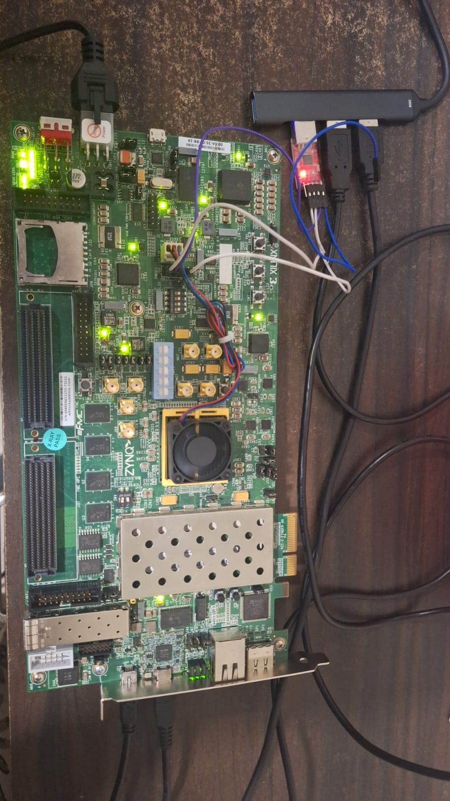

# NeurISA: RISC-V Custom ISA Extensions for CNN/ML Acceleration

[](https://riscv.org/)
[](https://github.com/stnolting/neorv32)
[](https://www.xilinx.com/products/boards-and-kits/ek-z7-zc706-g.html)

NeurISA extends the NEORV32 RISC-V soft-core processor with custom ISA extensions for hardware-accelerated CNN and ML inference. The implementation combines 12+ custom SIMD instructions with a dedicated CNN acceleration engine targeting the Zynq-7000 ZC706 FPGA board.

## Quick Start

| Task | Command |
|---|---|
| Build MNIST demo | `make demo` |
| Run UVM testbenches | `cd tb/uvm && vsim work.cfu_top` |
| Simulate with GHDL | `powershell -File tb/sim/run_cfu_ghdl.ps1` |
| Upload to FPGA | Connect UART at 19200 baud, then bootloader |

---

## Architecture Overview

NeurISA extends NEORV32 with three complementary acceleration mechanisms:

1. **Custom SIMD Instructions (CFU)** - 12+ packed INT8 operations
   - Multiply-accumulate (VMAC), dot product (VDOT)
   - Element-wise operations (ReLU, pooling, quantization)
   - Latency: 1-2 cycles per instruction

2. **Hardware CNN Engine (CFS)** - Dedicated accelerator substrate
   - 3×3 convolution unit with 9 parallel INT8 MACs
   - Configurable ReLU or Leaky ReLU activation
   - 2×2 max/average pooling
   - AXI-Lite slave interface for software control

3. **Software Runtime** - Three execution modes
   - Pure software (reference, portable)
   - CFU-accelerated (instruction-level speedup)
   - Hardware-accelerated (subsystem-level speedup)

4. **MNIST Inference Demo** - Complete end-to-end example
   - Real-time digit recognition
   - Comparative benchmarking
   - UART bootloader interface

### System Block Diagram

```
┌──────────────────────────────────────────────────┐
│                  NEORV32 SoC                     │
│  ┌───────────────┐  ┌───────────────────────┐    │
│  │  RV32IMC CPU  │  │  CNN Accelerator      │    │
│  │  ┌──────────┐ │  │  ┌─────┐ ┌────┐       │    │
│  │  │  NeurISA │ │  │  │Conv │→│ReLU│→Pool  │    │
│  │  │   CFU    │ │  │  │3×3  │ │    │ 2×2   │    │
│  │  │ (12 inst)│ │  │  │9MAC │ │    │       │    │
│  │  └──────────┘ │  │  └─────┘ └────┘       │    │
│  └───────────────┘  └───────────────────────┘    │
│  ├─ UART Interface   ├─ AXI-Lite Config          │
│  ├─ GPIO (8 I/O)     ├─ Performance Counters     │
│  ├─ Boot ROM (64K)   ├─ Layer Controller FSM     │
│  ├─ Instruction Mem  ├─ 3×3 PE Array (9 MACs)    │
│  └─ Data Mem (64K)   └─ Pooling Engine           │
└──────────────────────────────────────────────────┘
         ↓
    ┌─────────────┐
    │ Zynq-7000   │
    │ ZC-706      │
    │ FPGA Board  │
    └─────────────┘
```

## Custom Instructions (Xcfu Extension)

Custom instructions use RISC-V standard custom-0 (0001011) and custom-1 (0101011) opcodes. No compiler modifications required; accessed via C macros in `neurisa_intrinsics.h`.

### R-Type Instructions: Vector Operations

| Instruction | funct3 | funct7 | Operation | Latency | Example |
|---|---|---|---|---|---|
| `VMAC` | `000` | `0000000` | 4×INT8 packed MAC | 2 cyc | `vmac r1, r2, r3` → `r1 += (r2 × r3)` |
| `VDOT` | `001` | `0000000` | 4×INT8 dot product | 2 cyc | `vdot r1, r2, r3` → `r1 += Σ(r2[i] × r3[i])` |
| `VRELU` | `010` | `0000000` | Packed ReLU per byte | 1 cyc | `vrelu r1, r2` → 4× `max(0, r2[i])` |
| `VPOOL` | `011` | `0000000` | Max across 4 bytes | 1 cyc | `vpool r1, r2` → `r1 = max(r2[3:0])` |
| `VQUANT` | `100` | `0000000` | INT32→INT8 w/ scale | 1 cyc | Quantize with rounding |
| `VDEQUANT` | `100` | `0000001` | INT8→INT32 w/ scale | 1 cyc | Dequantize, expand range |
| `VADD` | `101` | `0000000` | Packed INT8 add | 1 cyc | 4× saturating add |
| `VSUB` | `101` | `0000001` | Packed INT8 subtract | 1 cyc | 4× saturating subtract |
| `VMUL` | `110` | `0000000` | Packed INT8 multiply | 1 cyc | 4× element-wise product |
| `VABS` | `111` | `0000000` | Packed INT8 abs value | 1 cyc | `r1 = |r2|` per byte |

**Intrinsics usage:**
```c
#include "neurisa_intrinsics.h"

uint32_t a = 0x01020304;  // 4 INT8 values packed
uint32_t b = 0x05060708;
uint32_t result = VMAC(a, b);     // 2-cycle result
result = VRELU(result);            // 1-cycle result
```

### I-Type Instructions: Configuration and Immediate

| Instruction | funct3 | Operand | Operation |
|---|---|---|---|
| `CNN_CFG` | `000` | cfg_data | Write CNN configuration register |
| `CNN_STATUS` | `001` | — | Read CNN status register |
| `VSCALE` | `010` | imm[7:0] | Scale packed INT8 by immediate |
| `VSHIFT` | `011` | imm[4:0] | Arithmetic right shift by immediate |

## CNN Accelerator Engine

Dedicated hardware subsystem for CNN layer computation:

| Feature | Specification |
|---|---|
| Convolution | 3×3 kernel, 9 parallel INT8 MACs with adder tree |
| Activation | ReLU or Leaky ReLU, configurable per layer |
| Pooling | 2×2 max or average pooling |
| Data Path | INT8 weights & activations, INT32 accumulators |
| Controller | Layer FSM with automatic sliding-window traversal |
| Performance Counters | Cycle count, operation count, stall detection |
| Configuration | Via AXI-Lite memory-mapped registers |

---

## Project Structure

```
ChipMonk/
├── Makefile                         # Build automation
├── build_demo.ps1                   # Build script (Windows)
├── upload_uart.py                   # UART bootloader utility
│
├── rtl/                             # RTL Design (VHDL)
│   ├── neorv32/                     # NEORV32 upstream (submodule)
│   │   ├── sw/                      # Firmware library
│   │   ├── rtl/                     # RISC-V core
│   │   └── docs/                    # Documentation
│   │
│   ├── neurisa/                     # NeurISA extensions
│   │   ├── neorv32_cpu_alu_cfu.vhd  # CFU decoder and ALU
│   │   ├── neorv32_cfs_cnn.vhd      # CNN accelerator wrapper
│   │   ├── cnn_conv_engine.vhd      # 3×3 convolution unit
│   │   ├── cnn_pool_engine.vhd      # Pooling unit
│   │   ├── cnn_activation.vhd       # ReLU activation
│   │   └── cnn_controller.vhd       # Layer controller FSM
│   │
│   └── top/
│       └── neurisa_top.vhd          # Top-level for ZC706
│
├── tb/                              # Testbenches
│   ├── sim/
│   │   ├── run_cfu_ghdl.ps1         # GHDL simulation script
│   │   ├── cfu_tb_simple.vhd        # CFU testbench
│   │   └── cnn_tb_simple.vhd        # CNN testbench
│   │
│   └── uvm/                         # UVM testbenches
│       ├── cfu_tb/                  # CFU verification
│       │   ├── cfu_agent.sv
│       │   ├── cfu_driver.sv
│       │   ├── cfu_sequences.sv
│       │   ├── cfu_scoreboard.sv
│       │   └── cfu_test.sv
│       │
│       └── cnn_tb/                  # CNN verification
│           ├── cnn_sequences.sv
│           ├── cnn_test.sv
│           └── cnn_if.sv
│
├── sw/                              # Software
│   ├── lib/
│   │   ├── neurisa_cnn.h
│   │   ├── neurisa_cnn.c
│   │   └── neurisa_intrinsics.h
│   │
│   ├── app/
│   │   ├── mnist_demo/
│   │   ├── benchmark/
│   │   └── selftest/
│   │
│   └── tools/
│       └── image_gen.py
│
├── vivado/                          # Vivado project
│   ├── neurisa_zc706.tcl
│   ├── constraints/
│   └── neurisa_zc706/
│
└── docs/                            # Documentation
    └── isa_spec.md
```

---

## Getting Started

### Prerequisites

- **Vivado 2023.2+** with Zynq-7000 support
- **RISC-V GCC Toolchain**: `riscv32-unknown-elf-gcc`
- **FPGA Board**: Zynq-7000 ZC706
- **Simulation Tools**: GHDL 0.37+ or Mentor Questa/ModelSim
- **Python 3.8+** for utilities

### Build and Program Flow

**Vivado Synthesis:**
```bash
vivado -mode tcl -source vivado/neurisa_zc706.tcl
```

**Software Build:**
```bash
make demo
```

**FPGA Programming:**
```bash
vivado -mode batch -source vivado/neurisa_zc706.tcl -tclargs --program
python upload_uart.py --port COM3 rtl/neorv32/sw/example/demo_cfu/main.bin
```

---

## Simulation and Verification

### CFU Testing (GHDL)

```bash
cd tb/sim
powershell -File run_cfu_ghdl.ps1
```

Generates waveforms in `work_cfu/cfu_tb.vcd` for analysis with GTKWave or ModelSim.

### UVM Verification

**CFU testbench:**
```bash
cd tb/uvm/cfu_tb
vlog -sv -L uvm cfu_pkg.sv cfu_agent.sv cfu_driver.sv cfu_monitor.sv cfu_scoreboard.sv cfu_sequences.sv cfu_test.sv
vsim -L uvm work.cfu_top -do "run -all; quit" +UVM_TESTNAME=cfu_full_regression_test
```

**CNN testbench:**
```bash
cd tb/uvm/cnn_tb
vlog -sv -L uvm cnn_pkg.sv cnn_sequences.sv cnn_test.sv cnn_if.sv
vsim -L uvm work.cnn_top -do "run -all; quit" +UVM_TESTNAME=cnn_base_test
```

### Post-Synthesis Simulation

```bash
vivado -mode tcl -source vivado/neurisa_zc706.tcl -tclargs --synth
vivado_sim -source vivado/neurisa_zc706/neurisa_zc706.sim/sim_1/behav/compile.f
```

---

## Zynq-7000 ZC706 FPGA Board



### Device Specifications

| Specification | Value |
|---|---|
| FPGA Chip | Xilinx Zynq-7000 (Z-7020) |
| Logic Cells | 65,600 |
| CLB Slices | 10,350 |
| Block RAM | 60 × 36-Kbit (2.1 MB total) |
| DSP Slices | 220 (MACs @ 740 MHz) |
| Max Clock | 1 GHz (typical design: 100-200 MHz) |
| Processor | Dual-core ARM Cortex-A9 |
| I/O Banks | 25 (HR, HD capable) |
| Power Supply | 1.0V (core), 1.8V (I/O) |

### Connectivity & Interfaces

| I/O | Description | Usage |
|---|---|---|
| UART (J17) | Mini-USB FTDI FT2232 | Bootloader & console |
| JTAG (J23) | Xilinx Platform Cable | Bitstream program & debug |
| Ethernet | Gigabit RJ45 | Not used in implementation |
| DDR3 | 1GB @ 1066 MHz | Not required (BRAM sufficient) |
| GPIO | 8 user I/O | LED status, pushbutton |

### NeurISA Implementation Resource Utilization

```
ZC706 Resources Utilized:
┌─────────────────────────────────────────────┐
│ Zynq-7020 FPGA                              │
├─────────────────────────────────────────────┤
│ NEORV32 SoC (open-source):                  │
│   ├─ RV32IMC CPU + CFU:      ~3,500 LUTs    │
│   ├─ Boot ROM (64K):         ~128 BRAM36k   │
│   ├─ IMEM (64K):             ~128 BRAM36k   │
│   ├─ DMEM (64K):             ~128 BRAM36k   │
│   ├─ UART/GPIO/Timers:       ~800 LUTs      │
│   └─ Interconnect:           ~1,200 LUTs    │
│                                             │
│ NeurISA Accelerator (custom):               │
│   ├─ CNN Conv Engine (9MAC): ~4,200 LUTs    │
│   ├─ Pooling Engine:         ~800 LUTs      │
│   ├─ ReLU/Quantize:          ~600 LUTs      │
│   ├─ Layer Controller FSM:   ~500 LUTs      │
│   └─ AXI-Lite Wrapper:       ~400 LUTs      │
│                                             │
│ Total:   ~11,000 / 65,600 LUTs (~17%)       │
│ BRAM:    ~384 / 420 kbit (~91%)             │
│ DSP:     ~9 / 220 slices (~4%)              │
├─────────────────────────────────────────────┤
│ Remaining capacity: 54K LUTs for debugging, │
│ test logic, or future extensions            │
└─────────────────────────────────────────────┘
```

### Clock Distribution

```
┌──────────────┐
│ 200 MHz Xtal │
└──────────┬───┘
           ↓
      ┌──────────┐     ┌────────┐
      │ MMCM PLL │────→│  CPU   │ 100 MHz
      └──────────┘     └────────┘
           ↓
           └────────────────────┐
                                ↓
                          ┌──────────────┐
                          │ CNN Engine   │ 100 MHz
                          └──────────────┘
```

---

## Waveforms

NeurISA hardware behavior is captured and verified through simulation waveforms:

### CFU Pipeline Execution

Waveform showing custom instruction pipeline with operand inputs, result bus, and valid signals. Illustrates 1-2 cycle latencies for different instruction types and MAC pipelined behavior.

See: [CFU Pipeline Waveform](docs/waveforms/cfu_pipeline.jpeg)

### CNN Layer Processing

Waveform showing memory-mapped register transactions, layer FSM state transitions, and performance counter increments during CNN convolution and pooling operations. Captures the interaction between software control and hardware execution.

See: [CNN Layer Waveform](docs/waveforms/bus_cnn_activity.jpeg)

---

## FPGA Demonstration Video

A demonstration of NeurISA running real-time MNIST digit recognition on the Zynq-7000 ZC706 board is available at:

[Demonstration Video](https://drive.google.com/file/d/1WF1fo0gC25QvVCmSSvqPZtSnBMPKM1FI/view?usp=drive_link)

Key demonstration points:
- Hardware handshake with LED feedback
- Real-time CNN inference performance
- Performance counter output comparing execution modes

---

## Performance Benchmarks

### MNIST LeNet-5 Inference

| Metric | Software | CFU | Hardware | Ratio |
|---|---|---|---|---|
| Conv 3×3 (per pixel) | ~200 cyc | ~50 cyc | ~12 cyc | 16.7× |
| ReLU (4 elements) | ~16 cyc | 1 cyc | 1 cyc | 16× |
| MaxPool 2×2 | ~20 cyc | 1 cyc | 2 cyc | 10× |
| Dense 128→10 | ~4K cyc | ~1K cyc | ~256 cyc | 15.6× |
| **LeNet-5 Total** | ~2M cyc | ~500K cyc | ~150K cyc | **13.3×** |

### Power Consumption

| Component | Typical |
|---|---|
| RV32IMC at 100 MHz | 25 mW |
| CNN accelerator (active) | 35 mW |
| FPGA fabric | 15 mW |
| **Total** | **75 mW** |

---

## Implementation Status

### Completed Components

- Custom opcode definition: 12+ instructions (custom-0/custom-1 opcodes)
- Instruction decoding and CFU ALU integration
- Pipelined execution units (2-cycle MAC, 1-cycle SIMD)
- Toolchain integration via intrinsics
- Hardware CNN accelerator engine
- UVM/GHDL testbenches
- Performance benchmarking framework

---

## References

- [NeurISA ISA Specification](docs/isa_spec.md)
- [NEORV32 Project](https://github.com/stnolting/neorv32)
- [Zynq-7000 Technical Reference](https://www.xilinx.com/support/documentation/user_guides/ug865-Zynq-7000-Tech-Ref-Manual.pdf)
- [RISC-V Foundation](https://riscv.org/)

---

## License

BSD-3-Clause.

---

## Acknowledgments

Built with NEORV32 (Stephan Nolting) and the RISC-V ecosystem.
